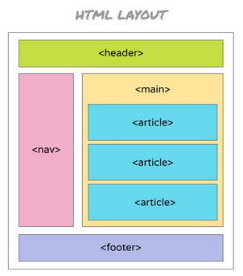

# Actividad 1: Maquetación

Maqueta la siguiente imagen manteniendo los colores y rellenando texto e imágenes para dar aspecto de producto final. Puedes usar lore ipsum para rellenar texto si quieres, no es obligatorio rellenar.

La imagen a maquetar es la siguiente: 
