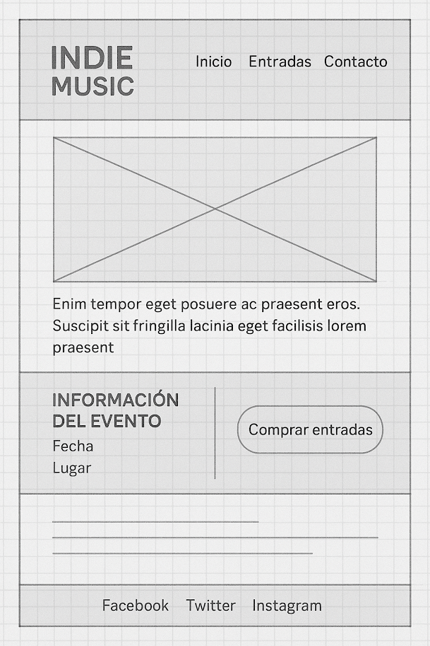

# Act 3 - CSS_T1: Layout, Mediaquery, Darkmode, Fontawesome

Guía de práctica: Landing Page con inline-block, Media Queries y Dark Mode

Tiempo estimado: 2 horas

## Objetivo de la práctica

- Aprender a maquetar sin flex ni grid, únicamente con inline-block.
- Usar @media queries con la sintaxis nueva (width <= 600px) para adaptar el diseño a móvil.
- Implementar modo oscuro automático con @media (prefers-color-scheme: dark).

## Temática de la landing

"Concierto de música indie"

Una página de promoción de un evento musical.

## Imagen de Referencia



## Estructura HTML

- Header con el nombre del festival y un menú simple (Inicio | Entradas | Contacto).
- Section principal con:
- Una imagen destacada del concierto (usar placehold: `https://placehold.co/600x300`).
- Un texto de presentación en un div.

- Section secundaria con dos bloques al 50% (inline-block):
  - Izquierda → información del evento (fecha, lugar).
  - Derecha → botón simulado para "Comprar entradas".

- Footer con iconos de redes sociales usando Font Awesome (Facebook, Twitter, Instagram).

## Estilos CSS

- General: box-sizing: border-box; fuente sans-serif.
- Colores modo claro: fondo amarillo claro (#ffeb3b), texto negro.
- Colores modo oscuro: fondo negro, texto amarillo.
- Menú con elementos inline-block.
- Los bloques de la sección secundaria al 50% con inline-block.
- Cuando (width <= 600px) :
- El menú pasa de horizontal a vertical.
- Los bloques de la sección secundaria pasan de 50% a 100% (block).

## Ítems obligatorios

- Uso de al menos 2 elementos inline-block al 50%.
- Uso de media queries Level 4 con (width <= 600px).
- Uso de modo oscuro automático con @media (prefers-color-scheme: dark).
- Al menos una imagen con placehold.co.
- Footer con iconos de redes sociales usando Font Awesome.
- Uso de al menos un icono adicional de Font Awesome en otra parte de la página (ejemplo: 🎵, 📍, 📅).

## Bonus (para quien acabe antes)

- Añadir hover en el botón de "Comprar entradas".
- Usar :hover o :active en el menú.
- Cambiar la tipografía en modo oscuro.

Ejemplo en el footer:

```html
<footer>
    <a href="#"><i class="fab fa-facebook"></i></a>
    <a href="#"><i class="fab fa-twitter"></i></a>
    <a href="#"><i class="fab fa-instagram"></i></a>
</footer>
```

## Calificación

- Estructura básica de la landing (HTML semántico con header, secciones y footer) → 10 puntos
- Maquetación con inline-block (dos bloques al 50% correctamente alineados) → 8 puntos
- Media queries Level 4 (cuando width <= 600px, bloques pasan a 100% y menú vertical) → 8 puntos
- Modo oscuro automático con @media (prefers-color-scheme: dark) → 6 puntos
- Uso de Font Awesome en el footer (redes sociales con iconos) → 4 puntos
- Uso de al menos un icono adicional de Font Awesome en otra parte de la página → 2 puntos
- Imagen destacada con placeholder.com → 2 puntos

*Powered by ChatGPT, supervisado por un profe con café. Ningún robot fue dañado en la creación de este ejercicio.

## En un comentario privado, indica

- Porcentaje de trabajo realizado.
- Puntuación de autoevaluación según la rúbrica.
- Problemas técnicos encontrados.
