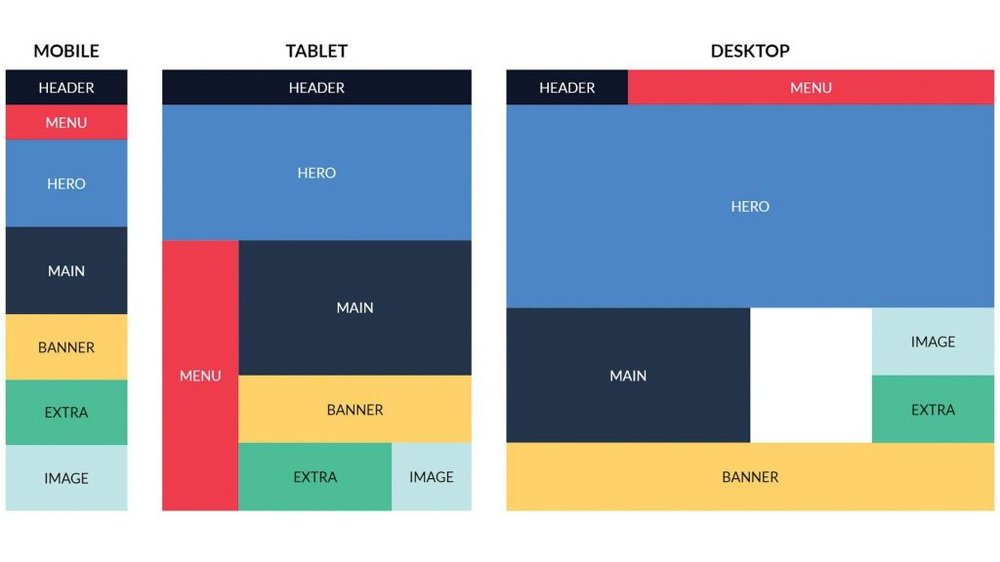

# Actividad 4 - Flex Ini

Haz el diseño de la imagen:

Utilizando flexbox y media queries. El diseño debe ser responsive y adaptarse a diferentes tamaños de pantalla.

Modificación en tarea: No realizar el diseño de tablet, necesitaría demasiadas modificaciones en el HTML. Hacer la de móvil y si fuere posible, la de escritorio.

Recomendación: Empezar por la de dispositivo móvil.
