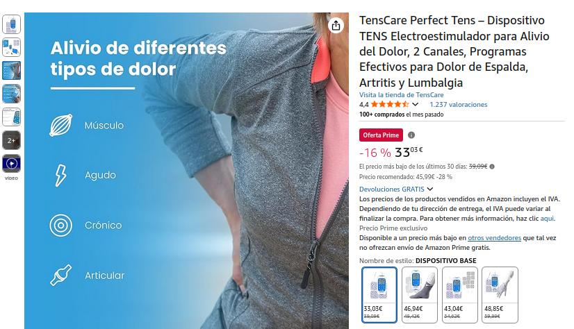

# Actividad 5 - Premisa

Reproducid las siguientes cuadrículas con flex, no es necesario que pongáis el texto. Si queréis podéis hacer capturas de las imágenes y añadidlas.

Sólo vista de escritorio.
