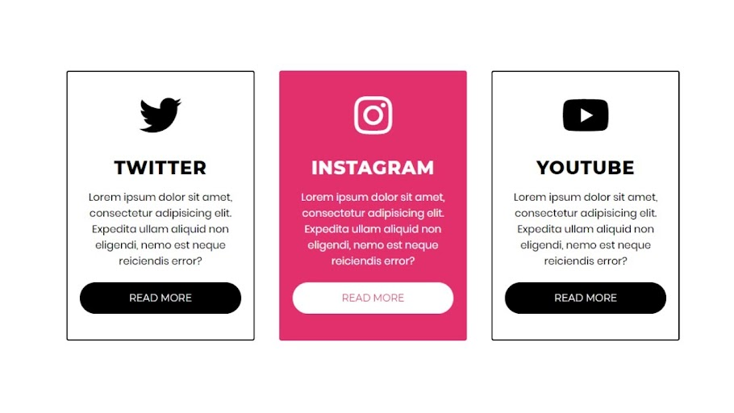

# Premisa Actividad 6

Crea en HTML+CSS las siguientes tarjetas:

- Usar biblioteca de iconos
- Al pasar el ratón por encima, cambiar al estilo de la imagen central.
- Media queries para adaptar el contenido.

Imagen de referencia:

