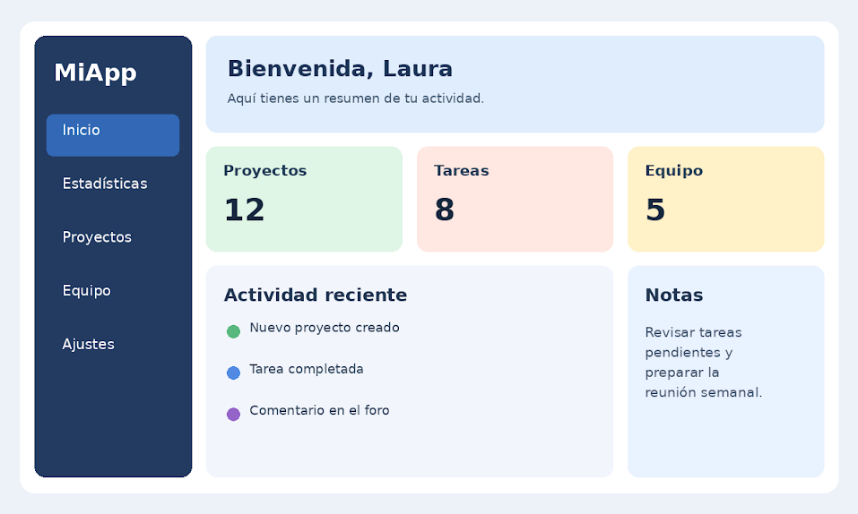

# Premisa Act7 - Maquetación Dashboard

Una empresa de desarrollo de software necesita crear el panel de control de su aplicación de gestión de proyectos.

Se proporciona la estructura básica HTML de la página y el diseño del panel. Tu trabajo consiste en desarrollar los estilos CSS necesarios para reproducir el diseño de la imagen de referencia.

Requisitos:

1. Utiliza CSS Grid para organizar los elementos del panel.
2. El contenedor principal debe tener cuatro columnas: una columna lateral de 250 px y otras tres columnas que compartan el espacio restante.
3. Define tres filas para organizar el contenido.
4. El menú lateral debe ocupar las tres filas.
5. La cabecera debe ocupar las tres columnas situadas a la derecha del menú.
6. Las tarjetas de proyectos, tareas y equipo deben aparecer en una misma fila.
7. La sección de actividad reciente debe ocupar dos columnas de la última fila, mientras que la sección de notas ocupará la columna restante.
8. Establece una separación de 20 px entre los elementos.
9. Aplica colores de fondo, bordes redondeados, sombras y estilos tipográficos para conseguir un resultado similar a la imagen.
Condiciones: debes utilizar grid-template-columns, grid-template-rows, grid-column y grid-row. No puedes utilizar Flexbox para establecer la distribución principal.
10. Añade las modificaciones que necesites para crear las vistas de móvil y tablet.

Imagen de referencia: 

HTML Base:

```
<!DOCTYPE html>
<html lang="es">
<head>
  <meta charset="UTF-8">
  <meta name="viewport" content="width=device-width, initial-scale=1.0">
  <title>Práctica Grid · Dashboard</title>
  <link rel="stylesheet" href="parte1_dashboard.css">
</head>
<body>
  <div class="dashboard">
    <aside class="sidebar"></aside>

    <header class="cabecera"></header>

    <section class="tarjeta proyectos" aria-label="Proyectos"></section>
    <section class="tarjeta tareas" aria-label="Tareas"></section>
    <section class="tarjeta equipo" aria-label="Equipo"></section>

    <section class="tarjeta actividad"></section>
    <section class="tarjeta notas"></section>
  </div>
</body>
</html>
```
