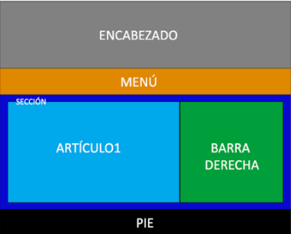
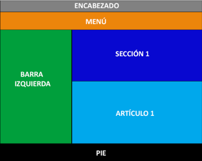
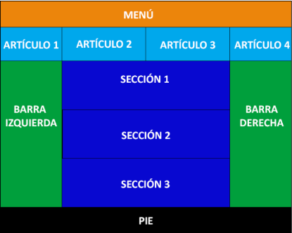
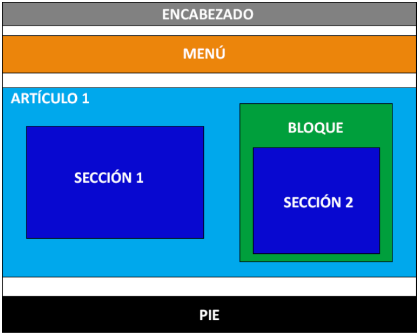

# PREMISA ACT6 - USO DE DIVS

Debes de realizar las siguientes estructuras en HTML utilizando DIV, puedes usar colores similares, porcentajes para los tamaños o darle un tamaño fijo, pero que tenga la misma estructura de la imagen.

Cada actividad es un html, hacéis 4 html, y lo enviáis a una carpeta .zip

## Enunciado 1

## Enunciado 2

## Enunciado 3

## Enunciado 4

## Enlaces de ayuda

- [W3Schools - HTML Div Tag](https://www.w3schools.com/tags/tag_div.asp)

- [MDN Web Docs - CSS Flexible Box Layout](https://developer.mozilla.org/en-US/docs/Web/CSS/Guides/Flexible_box_layout/Basic_concepts)
