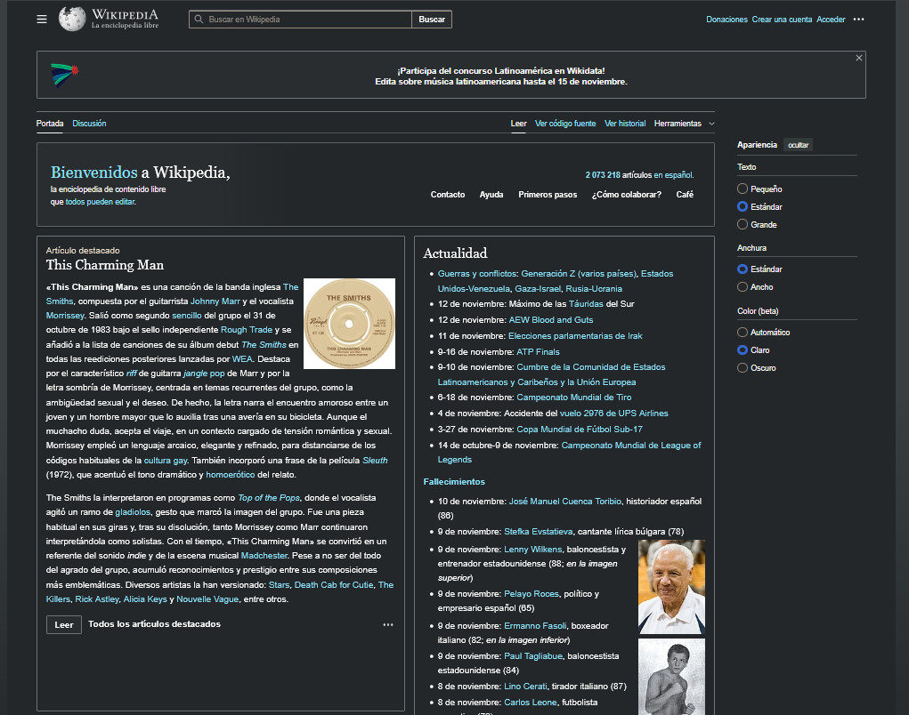

# HTML5 - José Ángel Alejo - ITP 1ºDAW - Lenguajes de Marcas

- [HTML5 - José Ángel Alejo - ITP 1ºDAW - Lenguajes de Marcas](#html5---josé-ángel-alejo---itp-1ºdaw---lenguajes-de-marcas)
  - [**1. INTRODUCCIÓN**](#1-introducción)
  - [**ESTRUCTURA BÁSICA DE UN DOCUMENTO HTML5**](#estructura-básica-de-un-documento-html5)
  - [**2. ETIQUETAS Y ATRIBUTOS**](#2-etiquetas-y-atributos)
  - [**3. ELEMENTOS**](#3-elementos)
    - [**FORMATEAR PÁRRAFOS**](#formatear-párrafos)
    - [**HEADERS (ENCABEZADOS)**](#headers-encabezados)
    - [**CONTENIDO MULTIMEDIA**](#contenido-multimedia)
      - [**IMÁGENES**](#imágenes)
      - [**AUDIO Y VÍDEO**](#audio-y-vídeo)
  - [**ELEMENTOS SEMÁNTICOS**](#elementos-semánticos)
    - [**LISTAS**](#listas)
      - [Listas ordenadas](#listas-ordenadas)
      - [Listas desordenadas](#listas-desordenadas)
      - [Listas de definición](#listas-de-definición)
      - [Listas anidadas](#listas-anidadas)
    - [**TABLAS**](#tablas)
    - [**FORMULARIOS**](#formularios)
  - [**ELEMENTOS ESTRUCTURALES**](#elementos-estructurales)
    - [**DIVS (CONTENEDORES)**](#divs-contenedores)
    - [Excepciones en propiedades de style](#excepciones-en-propiedades-de-style)
    - [Excepciones en flexbox](#excepciones-en-flexbox)
    - [Otras opciones para layouts](#otras-opciones-para-layouts)
  - [Ejemplos prácticos](#ejemplos-prácticos)
    - [Ejemplo 1: Página web simple](#ejemplo-1-página-web-simple)
    - [Ejemplo 2: Tabla y formulario](#ejemplo-2-tabla-y-formulario)
    - [Ejemplo 3: Diseño con Flexbox](#ejemplo-3-diseño-con-flexbox)
  - [**PARA EXAMEN**](#para-examen)
    - [**Página de ejemplo para el examen**](#página-de-ejemplo-para-el-examen)

---
<div style="page-break-after: always;"></div>

## **1. INTRODUCCIÓN**

**HTML5 es la quinta versión del lenguaje de marcado HTML (HyperText Markup Language)** utilizado para estructurar y presentar contenido en la web. Para ello, HTML5 introduce nuevas etiquetas y atributos que facilitan la creación de páginas web más dinámicas y multimedia, mejorando la experiencia del usuario y la accesibilidad.

## **ESTRUCTURA BÁSICA DE UN DOCUMENTO HTML5**

Una estructura básica de un documento HTML5 incluye las siguientes partes:

- PRÓLOGO: Debe incluir la declaración del tipo de documento `<!DOCTYPE html>` para indicar que se está utilizando HTML5.
- EJEMPLAR (raíz): Contiene el elemento `<html>` que envuelve todo el contenido de la página. Se cierra con `</html>`.
  - CABECERA: Se define con la etiqueta `<head>` y contiene información sobre el documento, como el título y los metadatos. Se cierra con `</head>`. Debe incluir:
    - `<meta charset="UTF-8">`: Define la codificación de caracteres.
    - `<meta name="viewport" content="width=device-width, initial-scale=1.0">`: Hace que el diseño sea responsivo.
    - `<title>`: Define el título de la página que aparece en la pestaña del navegador.
  - CUERPO: Se define con la etiqueta `<body>` y contiene el contenido visible de la página. Se cierra con `</body>`.

De esta forma, la estructura básica de un documento HTML5 se vería así:

```html
<!DOCTYPE html>
<html lang="es">
<head>
    <meta charset="UTF-8">
    <meta name="viewport" content="width=device-width, initial-scale=1.0"> <!-- "width=device-width" hace que el diseño sea responsivo, ajustándose al ancho de la página. "initial-scale=1.0" establece el nivel de zoom inicial -->
    <title>Título de la Página</title>
    <link rel="icon" type="image/x-icon" href="favicon.ico"> <!-- Con esta línea indicamos un icono personalizado para la pestaña del navegador. Podemos indicarlo con una ruta relativa o absoluta -->
</head>
<body>
    <!-- Contenido de la página -->
</body>
</html>
```

## **2. ETIQUETAS Y ATRIBUTOS**

Un documento HTML se compone de **etiquetas** (tags) que **definen la estructura y el contenido de la página web**. Estas etiquetas serán de apertura y cierre, y pueden contener texto, otros elementos o atributos. Debido a que HTML5 tiene gran cantidad de etiquetas, pero son limitadas, utilizamos atributos para modificar su comportamiento o apariencia.

Algunas **etiquetas comunes** son:

- **`<p>`**: Define un párrafo. Se ve así: `<p>Este es un párrafo.</p>`.
- **`<h1>` a `<h6>`**: Definen encabezados de diferentes niveles, siendo `<h1>` el más importante y `<h6>` el menos importante. Se ve así: `<h1>Encabezado de nivel 1</h1>`. En un HTML5, solo debe haber un `<h1>` por página.
- **`<a>`**: Define un hipervínculo. Se ve así: `<a href="https://www.ejemplo.com">Visitar Ejemplo</a>`.
- **``**: Inserta una imagen. Se ve así: ``.
- **`<div>`**: Define una sección o contenedor genérico. Se ve así: `<div>Contenido del contenedor</div>`.
- **`<span>`**: Define un contenedor en línea para aplicar estilos o atributos a una parte del texto. Se ve así: `<span style="color: red;">Texto en rojo</span>`.
- **`<br>`**: Inserta un salto de línea. Se ve así: `Primera línea<br>Segunda línea`.
- **`<hr>`**: Inserta una línea horizontal para separar contenido. Se ve así: `<hr>`.

Los **atributos** proporcionan información adicional sobre un elemento HTML y se incluyen dentro de la etiqueta de apertura, permitiendo **modificar el comportamiento o la apariencia de un elemento**. Cada **atributo tiene un nombre y un valor, separados por un signo igual** (`=`) y el valor se encierra entre comillas.

Algunos **atributos comunes** son:

- **`name`**: Define el nombre de un elemento. Por ejemplo, `name="username"` en un campo de formulario. Se vería así: `<input type="text" name="username">`.
- **`title`**: Proporciona información adicional sobre un elemento, que generalmente se muestra como una sugerencia al pasar el cursor sobre él. Por ejemplo, `title="Este es un enlace a la página principal"` en un enlace. Se vería así: `<a href="index.html" title="Este es un enlace a la página principal">Inicio</a>`.
- **`id`**: Asigna un identificador único a un elemento HTML, que puede ser utilizado para estilos CSS o scripts JavaScript. Por ejemplo, `id="header"` en un encabezado. Se vería así: `<h1 id="header">Bienvenido</h1>`.
- **`style`**: Permite aplicar estilos CSS directamente a un elemento HTML. Por ejemplo, `style="color: red;"` para cambiar el color del texto a rojo. Se vería así: `<p style="color: red;">Este es un párrafo rojo.</p>`. Es el atributo más básico para aplicar estilos en línea.
- **`class`**: Asigna una o más clases a un elemento HTML, que pueden ser utilizadas para aplicar estilos CSS o scripts JavaScript. Por ejemplo, `class="highlight"` en un párrafo. Se vería así: `<p class="highlight">Este es un párrafo destacado.</p>`.
- **`href`**: Especifica la URL de destino de un hipervínculo. Por ejemplo, `href="https://www.ejemplo.com"` en un enlace. Se vería así: `<a href="https://www.ejemplo.com">Visitar Ejemplo</a>`.
  - **`src`**: Especifica la fuente de un recurso, como una imagen o un archivo multimedia. Por ejemplo, `src="imagen.jpg"` en una etiqueta de imagen. Se vería así: ``.
  - **`alt`**: Proporciona una descripción alternativa para una imagen, que se muestra si la imagen no se puede cargar. Por ejemplo, `alt="Descripción de la imagen"` en una etiqueta de imagen. Se vería así: ``.
- **`size`**: Define el tamaño de un elemento, como un campo de entrada. Por ejemplo, `size="30"` en un campo de texto. Se vería así: `<input type="text" size="30">`.
- **`type`**: Especifica el tipo de un elemento, como un campo de entrada o un botón. Por ejemplo, `type="submit"` en un botón de envío. Se vería así: `<input type="submit" value="Enviar">`.
- **`color`**: Define el color de un elemento, como el texto o el fondo. Por ejemplo, `color="blue"` en una etiqueta de fuente (aunque esta etiqueta está obsoleta en HTML5). Se vería así: `<font color="blue">Texto azul</font>`.

## **3. ELEMENTOS**

Los elementos en HTML5 son las unidades básicas que componen una página web. Cada elemento está definido por una etiqueta de apertura y una etiqueta de cierre, y puede contener texto, otros elementos o atributos. A continuación, se describen algunos de los elementos más comunes en HTML5:

- **ELEMENTOS DE BLOQUE**: Son aquellos que ocupan todo el ancho disponible y comienzan en una nueva línea. Ejemplos: `<div>`, `<p>`, `<h1>` a `<h6>`, `<ul>`, `<ol>`, `<li>`, `<header>`, `<footer>`, `<section>`, `<article>`.

- **ELEMENTOS EN LÍNEA**: Son aquellos que no inician en una nueva línea y solo ocupan el ancho necesario. Ejemplos: `<span>`, `<a>`, ``, `<strong>`, `<em>`, `<br>`.

### **FORMATEAR PÁRRAFOS**

Para formatear párrafos en HTML5, se utilizan etiquetas que permiten aplicar estilos y estructura al texto. Algunas de las etiquetas más comunes para formatear párrafos incluyen:

- **`<h1>` a `<h6>`**: Definen encabezados de diferentes niveles.
- **`<p>`**: Define un párrafo. Se ve así: `<p>Este es un párrafo.</p>`.
- **`<pre>`**: Define un bloque de texto preformateado, que se muestra con un espaciado y una fuente monoespaciada. Se ve así: `<pre>Texto preformateado</pre>`.
- **`<br>`**: Inserta un salto de línea dentro de un párrafo. Se ve así: `Primera línea<br>Segunda línea`.
- **`<hr>`**: Inserta una línea horizontal para separar contenido. Se ve así: `<hr>`.
- **`<b>`**: Aplica negrita al texto. Se ve así: `<b>Texto en negrita</b>`.
- **`<i>`**: Aplica cursiva al texto. Se ve así: `<i>Texto en cursiva</i>`.
- **`<em>`**: Aplica énfasis al texto, generalmente representado en cursiva. Se ve así: `<em>Texto enfatizado</em>`.
- **`<u>`**: Aplica subrayado al texto. Se ve así: `<u>Texto subrayado</u>`.
- **`<small>`**: Reduce el tamaño del texto. Se ve así: `<small>Texto pequeño</small>`.
- **`<mark>`**: Resalta el texto. Se ve así: `<mark>Texto resaltado</mark>`.
- **`<ins>`**: Indica texto insertado. Se ve así: `<ins>Texto insertado</ins>`.
- **`<del>`**: Indica texto eliminado, generalmente representado con una línea atravesada. Se ve así: `<del>Texto eliminado</del>`.
- **`<sup>`**: Aplica superíndice al texto. Se ve así: `<sup>Texto en superíndice</sup>`.
- **`<sub>`**: Aplica subíndice al texto. Se ve así: `<sub>Texto en subíndice</sub>`.
- **`<strong>`**: Aplica un énfasis fuerte al texto, generalmente representado en negrita. Da importancia en motores de búsqueda. Se ve así: `<strong>Texto con énfasis fuerte</strong>`.
- **`<a>`**: Define un hipervínculo. Se ve así: `<a href="https://www.ejemplo.com">Visitar Ejemplo</a>`.

Algunas de las etiquetas mencionadas anteriormente, como `<h1>`, `<strong>`, `<em>` y `<mark>`, **dan importancia semántica al contenido**, lo que puede ser beneficioso para la accesibilidad y el SEO (optimización para motores de búsqueda).

### **HEADERS (ENCABEZADOS)**

A los hipervínculos se les pueden agregar varios atributos para definir su comportamiento y apariencia:

- **`href`**: Especifica la URL de destino del hipervínculo. Por ejemplo, `href="https://www.ejemplo.com"` en un enlace. Se vería así: `<a href="https://www.ejemplo.com">Visitar Ejemplo</a>`.
- **`target`**: Define dónde se abrirá el enlace. Los valores comunes son:
  - `_self`: Abre el enlace en la misma pestaña o ventana (valor predeterminado).
  - `_blank`: Abre el enlace en una nueva pestaña o ventana. Muy útil en dispositivos móviles para no perder la página original.
  
  Ejemplo: `<a href="https://www.ejemplo.com" target="_blank">Abrir en nueva pestaña</a>`.
- **`iframe`**: Permite incrustar un documento HTML dentro de otro utilizando la etiqueta `<iframe>`. Se ve así: `<iframe src="pagina.html" width="600" height="400"></iframe>`.

**Para crear un vínculo dentro del mismo documento**, se puede utilizar el atributo `id` para definir un punto de anclaje y luego enlazar a ese punto utilizando el símbolo `#` seguido del valor del `id`. Por ejemplo:

```html
<h2 id="seccion1">Sección 1</h2>
<p>Contenido de la sección 1.</p>
<a href="#seccion1">Ir a la Sección 1</a>
```

En este ejemplo, al hacer clic en el enlace "Ir a la Sección 1", el navegador se desplazará automáticamente a la sección correspondiente dentro del mismo documento.

### **CONTENIDO MULTIMEDIA**

A la hora de incorporar contenido multimedia en una página web utilizando HTML5, se pueden utilizar varias etiquetas específicas para manejar imágenes, audio y vídeo. Estas etiquetas permiten una integración sencilla y efectiva de medios en la web.

- Las **etiquetas estándar** según el tipo de contenido multimedia son:
  - `` para imágenes
  - `<audio>` para audio
  - `<video>` para vídeo

Estas etiquetas se utilizan con atributos específicos para definir la fuente del contenido, el tamaño, los controles de reproducción y otros aspectos relacionados con la presentación del medio.

#### **IMÁGENES**

La etiqueta `` se utiliza para insertar imágenes en una página web. Esta etiqueta es un elemento vacío, lo que significa que no tiene una etiqueta de cierre.

- Los **atributos más comunes utilizados con la etiqueta `` son:**
  - **`src`**: Especifica la ruta de la imagen que se va a mostrar. Puede ser una ruta relativa o absoluta. Ejemplo: ``.
  - **`alt`**: Proporciona una descripción alternativa de la imagen, que se muestra si la imagen no se puede cargar. También es importante para la accesibilidad, ya que los lectores de pantalla utilizan este texto para describir la imagen a los usuarios con discapacidades visuales. Ejemplo: ``.
  - **`width` y `height`**: Definen el ancho y la altura de la imagen en píxeles. Ejemplo: ``.
    - Si solo se especifica uno de estos atributos, el otro se ajustará automáticamente para mantener las proporciones originales de la imagen.
  - **`title`**: Proporciona información adicional sobre la imagen, que generalmente se muestra como una sugerencia al pasar el cursor sobre ella.
- **Algunos casos de uso adicionales incluyen:**
  - **Si queremos crear un hipervínculo en una imagen**, podemos envolver la etiqueta `` dentro de una etiqueta `<a>`, utilizando el atributo `href` para definir la URL de destino. Por ejemplo:
    - **`href`**: Define la URL de destino de un hipervínculo. Por ejemplo, `href="https://www.ejemplo.com"` en un enlace. Se vería así: `<a href="https://www.ejemplo.com">Visitar Ejemplo</a>`.
  - **Si la imagen se obtiene de una URL externa**, se puede utilizar la ruta absoluta en el atributo `src`. Por ejemplo:
    - ``.

#### **AUDIO Y VÍDEO**

**Para incorporar audio en una página web utilizando HTML5, se utiliza la etiquetas `<audio>`.**

Se debe especificar la fuente del archivo de audio utilizando la etiqueta `<source>` dentro del elemento `<audio>`.

**Es importante agregar el atributo `controls`** para que los usuarios puedan reproducir, pausar y controlar el volumen del audio. Además, se pueden incluir múltiples fuentes de audio para garantizar la compatibilidad con diferentes navegadores. Por ejemplo:

```html
<audio controls>
  <source src="audio.mp3" type="audio/mpeg">
  <source src="audio.ogg" type="audio/ogg">
  Tu navegador no soporta el elemento de audio.
</audio>
```

**Para incorporar vídeo en una página web utilizando HTML5, se utiliza la etiqueta `<video>`.**

Se debe especificar la fuente del archivo de vídeo utilizando la etiqueta `<source>` dentro del elemento `<video>`.

Es importante agregar el atributo `controls` para que los usuarios puedan reproducir, pausar y controlar el volumen del vídeo. Además, se pueden incluir múltiples fuentes de vídeo para garantizar la compatibilidad con diferentes navegadores. Por ejemplo:

```html
<video controls>
  <source src="video.mp4" type="video/mp4">
  <source src="video.ogg" type="video/ogg">
  Tu navegador no soporta el elemento de vídeo.
</video>
```

Además, **tenemos algunos atributos adicionales** que se pueden utilizar con las etiquetas `<audio>` y `<video>`:

- **`autoplay`**: Hace que el audio o vídeo se reproduzca automáticamente cuando la página se carga.
- **`loop`**: Hace que el audio o vídeo se reproduzca en bucle, reiniciándose automáticamente al finalizar.
- **`muted`**: Inicia el audio o vídeo sin sonido.

Tanto en el caso de audio como en el de vídeo **es recomendable indicar el tipo de archivo utilizando el atributo `type` en la etiqueta `<source>`, para asegurar la compatibilidad con diferentes navegadores.** EJEM

En el **caso de que el source sea en local** podemos usar rutas relativas (si se encuentra en la misma carpeta que el archivo html) o absolutas (si no se encuentra en la misma carpeta que el archivo html) para indicar la ubicación del archivo multimedia.

En el caso de que el **source sea externo**, podemos usar una URL absoluta para indicar la ubicación del archivo multimedia.

```html
<video controls>
  <source src="https://www.ejemplo.com/video.mp4" type="video/mp4">
  <source src="https://www.ejemplo.com/video.ogg" type="video/ogg">
  Tu navegador no soporta el elemento de vídeo.
</video>
```

Por otro lado, **si queremos incrustar un vídeo de una plataforma externa como YouTube o Vimeo**, podemos utilizar la etiqueta `<iframe>` con atributos específicos como `width`, `height`, `src`, `frameborder` y `allowfullscreen`.

Por ejemplo, para incrustar un vídeo de YouTube:

```html
<iframe width="560" height="315" src="https://www.youtube.com/embed/ID_DEL_VIDEO" frameborder="0" allowfullscreen></iframe>
```

El atributo `frameborder` define el grosor del borde del iframe (0 significa sin borde), y `allowfullscreen` permite que el vídeo se vea en pantalla completa.

Por otro lado, **si quisieramos centrar un audio, video u otro elemento en la página web, deberíamos utilizar etiquetas contenedoras como `<div>` junto con estilos CSS para lograr el centrado deseado.**

```html
<div style="text-align: center;">
  <audio controls>
    <source src="audio.mp3" type="audio/mpeg">
    Tu navegador no soporta el elemento de audio.
  </audio>
</div>
```

En este ejemplo, el contenedor `<div>` utiliza el estilo CSS `text-align: center;` para centrar el elemento de audio dentro de la página web.

## **ELEMENTOS SEMÁNTICOS**

Los elementos semánticos en HTML5 son aquellos que **aportan significado al contenido que envuelven**, facilitando la comprensión tanto para los desarrolladores como para los motores de búsqueda y tecnologías de asistencia. Estos elementos ayudan a estructurar el contenido de manera más clara y lógica, mejorando la accesibilidad y el SEO (optimización para motores de búsqueda).

- **Entre los elementos semánticos más comunes en HTML5 se encuentran:**
  - **Listas**: Se utilizan para **organizar datos en filas y columnas**. Pueden ser listas ordenadas (`<ol>`), listas desordenadas (`<ul>`) y listas de definición (`<dl>`).
  - **Tablas**: Se utilizan para **presentar datos tabulares de manera estructurada**. Pueden incluir encabezados (`<th>`), filas (`<tr>`) y celdas (`<td>`).
  - **Formularios**: Se utilizan para **recopilar información del usuario de manera organizada**. Pueden incluir campos de entrada (`<input>`), áreas de texto (`<textarea>`), botones (`<button>`) y otros elementos interactivos.

### **LISTAS**

Las listas en HTML5 se utilizan para **organizar información de manera estructurada**. Existen tres tipos principales de listas: Listas ordenadas, listas desordenadas y listas de definición.

#### Listas ordenadas

**Las listas ordenadas** serían el equivalente en Word a una lista numerada. Se crean utilizando la etiqueta `<ol>`, y cada elemento de la lista se define con la etiqueta `<li>`.

Dentro de una etiqueta `<ol>`, podemos utilizar el atributo `type` para especificar el tipo de numeración que deseamos utilizar. Los valores comunes para el atributo `type` son:

- `1`: Números (por defecto)
- `A`: Letras mayúsculas
- `a`: Letras minúsculas
- `I`: Números romanos mayúsculos
- `i`: Números romanos minúsculos

La estructura básica de una lista ordenada es la siguiente:

```html
<ol type="A">
  <li>Elemento 1</li>
  <li>Elemento 2</li>
  <li>Elemento 3</li>
</ol>
```

#### Listas desordenadas

**Las listas desordenadas** serían el equivalente en Word a una lista con viñetas. Se crean utilizando la etiqueta `<ul>`, y cada elemento de la lista también se define con la etiqueta `<li>`.

Dentro de una etiqueta `<ul>`, podemos utilizar el atributo `style` para especificar el tipo de viñeta que deseamos utilizar con el valor `list-style-type`. Los valores comunes para el atributo `list-style-type` son:

- `disc`: Viñeta sólida (por defecto)
- `circle`: Viñeta circular
- `square`: Viñeta cuadrada
- `none`: Sin viñeta

La estructura básica de una lista desordenada es la siguiente:

```html
<ul style="list-style-type: circle;">
  <li>Elemento 1</li>
  <li>Elemento 2</li>
  <li>Elemento 3</li>
</ul>
```

#### Listas de definición

**Las listas de definición** serían el equivalente en Word a una lista de definiciones. **Se crean utilizando la etiqueta `<dl>`**, que contiene pares de términos y descripciones. Cada término se define con la etiqueta `<dt>`, y cada descripción se define con la etiqueta `<dd>`.

La estructura básica de una lista de definición es la siguiente:

```html
<dl>
  <dt>Término 1</dt>
  <dd>Descripción del término 1.</dd>
  <dt>Término 2</dt>
  <dd>Descripción del término 2.</dd>
</dl>
```

#### Listas anidadas

**Las listas anidadas** son listas que contienen otras listas dentro de sus elementos. Esto permite crear estructuras más complejas y organizadas. Por ejemplo, una lista ordenada puede contener una lista desordenada dentro de uno de sus elementos:

```html
<ol>
  <li>Elemento 1
    <ul>
      <li>Subelemento 1.1</li>
      <li>Subelemento 1.2</li>
    </ul>
  </li>
  <li>Elemento 2</li>
</ol>
```

Una lista desordenada también puede contener una lista ordenada dentro de uno de sus elementos:

```html
<ul>
  <li>Elemento A
    <ol>
      <li>Subelemento A.1</li>
      <li>Subelemento A.2</li>
    </ol>
  </li>
  <li>Elemento B</li>
</ul>
```

Una lista de definición puede contener otra lista dentro de una descripción:

```html
<dl>
  <dt>Término 1</dt>
  <dd>
    Descripción del término 1.
    <ul>
      <li>Detalle 1.1</li>
      <li>Detalle 1.2</li>
    </ul>
  </dd>
  <dt>Término 2</dt>
  <dd>Descripción del término 2.</dd>
</dl>
```

También es posible anidar listas de diferentes tipos entre sí, creando estructuras jerárquicas complejas según las necesidades del contenido.

```html
<ol>
  <li>Elemento 1
    <ul>
      <li>Subelemento 1.1
        <dl>
          <dt>Definición 1.1.1</dt>
          <dd>Descripción de la definición 1.1.1.</dd>
        </dl>
      </li>
      <li>Subelemento 1.2</li>
    </ul>
  </li>
  <li>Elemento 2</li>
</ol>
```

### **TABLAS**

Las tablas en HTML5 se utilizan para **presentar datos tabulares de manera estructurada**. Una tabla se define utilizando la etiqueta `<table>`, que contiene varios elementos para organizar el contenido en filas y columnas.

- **Los elementos principales utilizados en una tabla son:**
  - **`<tr>`**: Define una fila en la tabla.
  - **`<th>`**: Define una celda de encabezado en la tabla. El texto dentro de `<th>` generalmente se muestra en negrita y centrado.
  - **`<td>`**: Define una celda de datos en la tabla.
- **Además, se pueden utilizar otros elementos para mejorar la estructura y presentación de la tabla:**
  - **`<thead>`**: Agrupa el contenido del encabezado de la tabla.
  - **`<colgroup>`**: Agrupa un conjunto de columnas en la tabla para aplicar estilos o atributos comunes. Un `<colgroup>` puede contener múltiples etiquetas `<col>`.
  - **`<col>`**: Define propiedades específicas para una columna dentro de un `<colgroup>`. Esta etiqueta posee atributos como:
    - **`span`**: Especifica cuántas columnas abarca.
    - **`width`**: Define el ancho de la columna.
    - **`align`**: Define la alineación del contenido dentro de la columna (por ejemplo, `left`, `center`, `right`).
    - **`style`**: Permite aplicar estilos CSS directamente a la columna. De esta forma, se pueden definir estilos específicos para una o varias columnas de la tabla.
  - **`<tbody>`**: Agrupa el contenido del cuerpo de la tabla.
  - **`<tfoot>`**: Agrupa el contenido del pie de la tabla.
  - **`<caption>`**: Define un título o leyenda para la tabla.

A continuación, se muestra un ejemplo de una tabla utilizando las etiquetas y atributos mencionados:

```html
<table>
    <caption>Ejemplo de Tabla</caption>
    <colgroup>
        <col span="2" style="background-color: #f2f2f2;">
        <col style="width: 100px;">
    </colgroup>
    <thead>
        <tr>
            <th>Nombre</th>
            <th>Edad</th>
            <th>Ciudad</th>
        </tr>
    </thead>
    <tbody>
        <tr>
            <td>Juan</td>
            <td>25</td>
            <td>Madrid</td>
        </tr>
        <tr>
            <td>María</td>
            <td>30</td>
            <td>Barcelona</td>
        </tr>
    </tbody>
    <tfoot>
        <tr>
            <td colspan="2">Total</td>
            <td>55</td>
        </tr>
    </tfoot>
</table>
```

Por otro lado, si queremos modificar las propiedades de una tabla y aplicar estilos específicos sin utilizar `<colgroup>` y `<col>`, podemos hacerlo directamente en la etiqueta `<table>` utilizando el atributo `style` para aplicar estilos CSS. El atributo `style` permite definir propiedades como el borde, el ancho, el color de fondo, entre otros.

- Las propiedades CSS más comunes que se pueden aplicar a una tabla incluyen:
  - `background-color`: Define el color de fondo de la tabla.
  - `background-image`: Permite establecer una imagen de fondo para la tabla. Se indica de la siguiente manera: `background-image: url('ruta/de/la/imagen.jpg');`.
  - `border`: Define el estilo, el ancho y el color del borde de la tabla. Se indica primero el ancho, luego el estilo y por último el color. Aunque es común usar la propiedad `border` para definir el borde de la tabla, también se pueden utilizar propiedades más específicas como:
    - `border-width`: Define el ancho del borde de la tabla.
    - `border-color`: Define el color del borde de la tabla.
    - `border-style`: Define el estilo del borde de la tabla. Algunos valores comunes son:
      - `solid`: Borde sólido.
      - `dashed`: Borde discontinuo.
      - `dotted`: Borde punteado.
      - `double`: Borde doble.
      - `groove`: Borde con efecto de ranura.
      - `ridge`: Borde con efecto de cresta. Da la apariencia de que la tabla está elevada.
      - `inset`: Borde con efecto de inserción. Da la apariencia de que la tabla está empotrada en la página.
      - `outset`: Borde con efecto de salida. Da la apariencia de que la tabla está saliendo de la página.
  - `border-collapse`: Controla si los bordes de las celdas se colapsan en un solo borde o se muestran separados. Sus valores pueden ser:
    - `collapse`: Los bordes de las celdas adyacentes se colapsan en un solo borde.
    - `separate`: Los bordes de las celdas se muestran separados (valor predeterminado).
  - `width` y `height`: Define el ancho y la altura de la tabla. Se puede especificar en píxeles o como un porcentaje del contenedor padre.
  - `min-width` y `max-width`: Definen el ancho mínimo y máximo de la tabla, respectivamente. Se pueden especificar en píxeles o como un porcentaje del contenedor padre.
  - `min-height` y `max-height`: Definen la altura mínima y máxima de la tabla, respectivamente. Se pueden especificar en píxeles o como un porcentaje del contenedor padre.
  - `padding`: Define el espacio entre el contenido de una celda y su borde.
  - `margin`: Define el espacio alrededor de la tabla. Se puede utilizar para centrar la tabla en la página.
    - Si se establece `margin: 0 auto;`, la tabla se centrará horizontalmente dentro de su contenedor padre.
  - Tanto `padding` como `margin` pueden tener valores individuales para cada lado (top, right, bottom, left) o un valor único que se aplica a todos los lados.
  - `text-align`: Define la alineación del texto dentro de las celdas (por ejemplo, `left`, `center`, `right`).
  - `vertical-align`: Define la alineación vertical del contenido dentro de las celdas. Sus valores pueden ser:
    - `top`: Alinea el contenido en la parte superior de la celda.
    - `middle`: Alinea el contenido en el centro vertical de la celda.
    - `bottom`: Alinea el contenido en la parte inferior de la celda.
  - `font-size`: Define el tamaño de la fuente del texto dentro de la tabla.
  - `color`: Define el color del texto dentro de la tabla.

### **FORMULARIOS**

Los formularios en HTML5 se utilizan para **recopilar información del usuario de manera estructurada**. Un formulario se define utilizando la etiqueta `<form>`, que puede contener varios elementos de entrada, como campos de texto, áreas de texto, botones y otros elementos interactivos.

Todos los elementos de un formulario deben estar contenidos dentro de la etiqueta `<form>`, que puede incluir atributos como `action` (la URL a la que se enviarán los datos del formulario) y `method` (el método HTTP utilizado para enviar los datos, con valores como `GET` o `POST`).

Además, los formularios pueden incluir etiquetas `<label>` para asociar descripciones a los campos de entrada, mejorando la accesibilidad y la usabilidad del formulario. Dentro de la etiqueta `<label>`, se puede utilizar el atributo `for` para vincular la etiqueta con un campo de entrada específico mediante su atributo `id`.

Por ello, es importante asignar un `id` único a cada campo de entrada y utilizar el mismo valor en el atributo `for` de la etiqueta `<label>` correspondiente.

Todas las entradas de datos se realizan mediante la etiqueta `<input>`. Las etiquetas `<input>` pueden tener distintos atributos, cada uno cumpliendo una función específica. Algunos de los atributos más comunes utilizados con la etiqueta `<input>` son:

- **El atributo `required` se utiliza para indicar que un campo de entrada es obligatorio**. Si un usuario intenta enviar el formulario sin completar un campo marcado como requerido, el navegador mostrará un mensaje de error y no permitirá el envío del formulario hasta que se complete el campo.
- **El atributo `type`**. Sirve para especificar el tipo de entrada que se espera del usuario. Algunos de los valores más comunes para el atributo type incluyen:
  - `text` para campos de texto de una sola línea.
  - `password` para campos de contraseña.
  - `email` para campos de correo electrónico.
  - `number` para campos numéricos.
  - `date` para campos de fecha.
  - `checkbox` para casillas de verificación.
  - `radio` para botones de opción.
  - `submit` para botones de envío del formulario.
  - `reset` para botones de reinicio del formulario.
- **El atributo `name` se utiliza para identificar** cada campo de entrada en el formulario. Este nombre es importante porque se utiliza para enviar los datos al servidor cuando se envía el formulario.
- **El atributo `value`** se utiliza para definir el valor predeterminado de un campo de entrada o el texto que aparece en un botón.
- **El atributo `accept` se utiliza en campos de entrada de tipo archivo (`type="file"`) para especificar los tipos de archivos que el usuario puede seleccionar**. Para permitir varios tipos, se separan con comas. Por ejemplo, `accept="image/png, image/jpeg"` permite seleccionar solo archivos PNG y JPEG.
- **El atributo `placeholder` se utiliza para proporcionar un texto de sugerencia dentro de un campo de entrada**, que desaparece cuando el usuario comienza a escribir. Por ejemplo, `placeholder="Ingrese su nombre"` muestra el texto "Ingrese su nombre" dentro del campo de texto hasta que el usuario escriba algo.
- **La etiqueta `<select>` se utiliza para crear un menú desplegable dentro de un formulario**. La etiqueta `<select>` se utiliza junto con la etiqueta `<option>` para definir las opciones disponibles en el menú desplegable. A la etiqueta `<select>` puede incluir atributos como `name` para identificar el campo y `multiple` para permitir la selección de múltiples opciones.
- **La etiqueta `<textarea>` se utiliza para crear un área de texto de varias líneas dentro de un formulario**. La etiqueta `<textarea>` permite a los usuarios ingresar texto más extenso en comparación con un campo de entrada de una sola línea. A la etiqueta `<textarea>` puede incluir atributos como `name` para identificar el campo, `rows` para definir el número de filas visibles y `cols` para definir el número de columnas visibles.

Ejemplo de un formulario utilizando las etiquetas y atributos mencionados:

```html
<!DOCTYPE html>
<html lang="es">
<head>
    <meta charset="UTF-8">
    <meta name="viewport" content="width=device-width, initial-scale=1.0">
    <title>Ejemplo de Formulario HTML5</title>
</head>
<body>
    <!-- El formulario agrupa todos los elementos de entrada para recopilar datos del usuario -->
    <form>
        <!-- Campo de texto obligatorio con placeholder y name para identificación -->
        <label for="nombre">Nombre:</label>
        <input type="text" id="nombre" name="nombre" placeholder="Ingresa tu nombre" required><br><br>

        <!-- Campo de contraseña para ocultar el texto -->
        <label for="password">Contraseña:</label>
        <input type="password" id="password" name="password"><br><br>

        <!-- Campo de email obligatorio con validación automática -->
        <label for="email">Correo electrónico:</label>
        <input type="email" id="email" name="email" required><br><br>

        <!-- Campo numérico con valor predeterminado -->
        <label for="edad">Edad:</label>
        <input type="number" id="edad" name="edad" value="18"><br><br>

        <!-- Campo de fecha para seleccionar una fecha -->
        <label for="fecha">Fecha de nacimiento:</label>
        <input type="date" id="fecha" name="fecha"><br><br>

        <!-- Casilla de verificación con name y value para enviar datos -->
        <label for="acepto">Acepto términos:</label>
        <input type="checkbox" id="acepto" name="acepto" value="si"><br><br>

        <!-- Botones de opción agrupados por name para selección única -->
        <label>Género:</label><br>
        <input type="radio" id="masculino" name="genero" value="masculino">
        <label for="masculino">Masculino</label><br>
        <input type="radio" id="femenino" name="genero" value="femenino">
        <label for="femenino">Femenino</label><br><br>

        <!-- Campo de archivo con restricción de tipos aceptados -->
        <label for="archivo">Subir archivo:</label>
        <input type="file" id="archivo" name="archivo" accept="image/png, image/jpeg"><br><br>

        <!-- Menú desplegable con opciones -->
        <label for="pais">País:</label>
        <select id="pais" name="pais">
            <option value="espana">España</option>
            <option value="mexico">México</option>
            <option value="argentina">Argentina</option>
        </select><br><br>

        <!-- Área de texto multilínea con tamaño definido y placeholder -->
        <label for="comentarios">Comentarios:</label><br>
        <textarea id="comentarios" name="comentarios" rows="4" cols="50" placeholder="Escribe tus comentarios aquí"></textarea><br><br>

        <!-- Botón para enviar el formulario -->
        <input type="submit" value="Enviar">
        <!-- Botón para reiniciar el formulario -->
        <input type="reset" value="Reiniciar">
    </form>
</body>
</html>
```

## **ELEMENTOS ESTRUCTURALES**

Los elementos estructurales en HTML5 son aquellos que **definen la estructura y organización del contenido de una página web**. Su función será contener otros elementos y ayudar a organizar el diseño de la página. Uno de los elementos estructurales más comunes es el `<div>`.

### **DIVS (CONTENEDORES)**

Los elementos `<div>` son contenedores genéricos utilizados para agrupar otros elementos y aplicarles estilos o comportamientos comunes mediante CSS.

Para aplicar estilos a un `<div>`, utilizamos el atributo `style`. Propiedades comunes incluyen:

- `border`: Define el estilo, ancho y color del borde (ej. `border: 1px solid black;`).
- `margin`: Define el espacio alrededor del `<div>` (ej. `margin: 10px;` para centrar: `margin: 0 auto;`).
- `padding`: Define el espacio interior entre el contenido y el borde (ej. `padding: 10px;`).
- `background-color`: Define el color de fondo (ej. `background-color: lightblue;`).
- `background-image`: Establece una imagen de fondo (ej. `background-image: url('ruta/imagen.jpg');`).
- `background-repeat`: Controla si la imagen se repite (valores: `repeat`, `repeat-x`, `repeat-y`, `no-repeat`).
- `background-size`: Define el tamaño de la imagen de fondo (valores: `auto`, `cover`, `contain`).
- `background-position`: Define la posición de la imagen (ej. `top left`, `center center`).
- `width` y `height`: Definen ancho y altura (en px o %).
- `min-width`, `max-width`, `min-height`, `max-height`: Definen límites de tamaño.
- `display`: Controla cómo se muestra el `<div>` (valores: `block` por defecto, `inline`, `inline-block`, `flex`, `inline-flex`).
- `justify-content`: Alinea elementos hijos en eje principal con flex (valores: `flex-start`, `center`, `flex-end`, `space-between`, `space-around`).
- `align-items`: Alinea elementos hijos en eje transversal con flex (valores: `flex-start`, `center`, `flex-end`, `stretch`).
- `flex-direction`: Define dirección eje principal con flex (valores: `row`, `column`).
- `text-align`: Alinea el texto (valores: `left`, `center`, `right`).
- `vertical-align`: Alinea verticalmente (valores: `top`, `middle`, `bottom`).
- `font-size`: Define el tamaño de la fuente.
- `color`: Define el color del texto.

### Excepciones en propiedades de style

Algunas propiedades pueden heredarse de elementos padres (ej. `font-size`, `color`) o no aplicarse según el valor de `display`. Por ejemplo:

- `width` y `height` no afectan cuando `display: inline;`.
- `margin-top` y `margin-bottom` no aplican cuando `display: inline;`.
- `vertical-align` solo aplica a elementos en línea o tabla (valores como `top`, `middle`, `bottom`).
- `background-repeat` con valores como `repeat-x` o `repeat-y` repiten solo en ejes específicos.
- `text-align` con valores como `left`, `center`, `right` alinean texto, pero no afectan a elementos de bloque sin texto.

### Excepciones en flexbox

- `justify-content` y `align-items` solo afectan a elementos hijos en contenedores flex; valores como `space-between` distribuyen espacio entre elementos, pero requieren al menos dos hijos.
- `flex-direction` con valores como `column` cambia el eje principal a vertical, afectando `justify-content`.
- Si se usa `flex` en hijos con valores numéricos (ej. `flex: 2;`), el espacio se reparte proporcionalmente; no usar `width` y `height` en ellos, ya que se calcula automáticamente. Valores como `flex: 0;` no permiten crecimiento.
- Para repartir espacio en hijos flex: usar `flex: 1;` (parte igual), `flex: 2;` (doble), etc. No usar `width`/`height` en hijos con `flex`.

### Otras opciones para layouts

- **Float**: Flota elementos a izquierda/derecha (valores: `left`, `right`, `none`).
- **Grid**: Sistema bidimensional para filas/columnas (activar con `display: grid;`, usar `grid-template-columns`, etc.).

Es recomendable utilizar hojas de estilo externas o internas para mantener separación entre contenido HTML y presentación visual.

---
<div style="page-break-after: always;"></div>

## Ejemplos prácticos

### Ejemplo 1: Página web simple

```html
<!DOCTYPE html>
<html lang="es">
<head>
    <meta charset="UTF-8">
    <meta name="viewport" content="width=device-width, initial-scale=1.0">
    <title>Página de Ejemplo</title>
    <style>
        body {
            font-family: Arial, sans-serif;
            margin: 0;
            padding: 0;
        }
        header {
            background-color: #007bff;
            color: white;
            padding: 10px 0;
            text-align: center;
        }
        nav {
            margin: 10px 0;
        }
        nav a {
            color: #007bff;
            margin: 0 15px;
            text-decoration: none;
        }
        nav a:hover {
            text-decoration: underline;
        }
        section {
            margin: 20px;
            padding: 20px;
            border: 1px solid #007bff;
            border-radius: 5px;
        }
        footer {
            text-align: center;
            padding: 10px 0;
            background-color: #f8f9fa;
            margin-top: 20px;
        }
    </style>
</head>
<body>

<header>
    <h1>Bienvenido a mi página web</h1>
</header>

<nav>
    <a href="#seccion1">Sección 1</a>
    <a href="#seccion2">Sección 2</a>
    <a href="#contacto">Contacto</a>
</nav>

<section id="seccion1">
    <h2>Sección 1</h2>
    <p>Esta es la primera sección de la página.</p>
</section>

<section id="seccion2">
    <h2>Sección 2</h2>
    <p>Esta es la segunda sección de la página.</p>
</section>

<footer id="contacto">
    <p>Contacto: miemail@ejemplo.com</p>
</footer>

</body>
</html>
```

### Ejemplo 2: Tabla y formulario

```html
<!DOCTYPE html>
<html lang="es">
<head>
    <meta charset="UTF-8">
    <meta name="viewport" content="width=device-width, initial-scale=1.0">
    <title>Tabla y Formulario</title>
    <style>
        body {
            font-family: Arial, sans-serif;
            margin: 0;
            padding: 0;
        }
        table {
            width: 100%;
            border-collapse: collapse;
            margin: 20px 0;
        }
        th, td {
            border: 1px solid #007bff;
            padding: 10px;
            text-align: left;
        }
        th {
            background-color: #007bff;
            color: white;
        }
        form {
            margin: 20px;
            padding: 20px;
            border: 1px solid #007bff;
            border-radius: 5px;
        }
        label {
            display: block;
            margin-bottom: 5px;
        }
        input, select, textarea {
            width: 100%;
            padding: 10px;
            margin-bottom: 10px;
            border: 1px solid #007bff;
            border-radius: 5px;
        }
        button {
            background-color: #007bff;
            color: white;
            padding: 10px 15px;
            border: none;
            border-radius: 5px;
            cursor: pointer;
        }
        button:hover {
            background-color: #0056b3;
        }
    </style>
</head>
<body>

<h1>Datos de Usuarios</h1>

<table>
    <thead>
        <tr>
            <th>Nombre</th>
            <th>Email</th>
            <th>Edad</th>
        </tr>
    </thead>
    <tbody>
        <tr>
            <td>Juan Pérez</td>
            <td>juanperez@email.com</td>
            <td>28</td>
        </tr>
        <tr>
            <td>María López</td>
            <td>marialopez@email.com</td>
            <td>32</td>
        </tr>
    </tbody>
</table>

<h2>Formulario de Contacto</h2>

<form action="/enviar-formulario" method="POST">
    <label for="nombre">Nombre:</label>
    <input type="text" id="nombre" name="nombre" required>

    <label for="email">Email:</label>
    <input type="email" id="email" name="email" required>

    <label for="edad">Edad:</label>
    <input type="number" id="edad" name="edad" min="1" max="120" required>

    <label for="mensaje">Mensaje:</label>
    <textarea id="mensaje" name="mensaje" rows="4" required></textarea>

    <button type="submit">Enviar</button>
</form>

</body>
</html>
```

### Ejemplo 3: Diseño con Flexbox

```html
<!DOCTYPE html>
<html lang="es">
<head>
    <meta charset="UTF-8">
    <meta name="viewport" content="width=device-width, initial-scale=1.0">
    <title>Diseño con Flexbox</title>
    <style>
        body {
            font-family: Arial, sans-serif;
            margin: 0;
            padding: 0;
        }
        .container {
            display: flex;
            flex-direction: row;
            justify-content: space-between;
            align-items: flex-start;
            margin: 20px;
        }
        .box {
            background-color: #007bff;
            color: white;
            padding: 20px;
            margin: 10px;
            flex: 1;
            min-width: 250px;
            box-shadow: 2px 2px 5px rgba(0, 0, 0, 0.1);
        }
        .box h2 {
            margin-top: 0;
        }
    </style>
</head>
<body>

<h1>Mi Portafolio</h1>

<div class="container">
    <div class="box">
        <h2>Sobre Mí</h2>
        <p>Hola, soy un apasionado del diseño web y desarrollo front-end.</p>
    </div>
    <div class="box">
        <h2>Proyectos</h2>
        <p>He trabajado en varios proyectos interesantes utilizando HTML, CSS y JavaScript.</p>
    </div>
    <div class="box">
        <h2>Contacto</h2>
        <p>Puedes contactarme a través de mi email: miemail@ejemplo.com</p>
    </div>
</div>

</body>
</html>
```

Estos ejemplos ilustran cómo se pueden utilizar las etiquetas HTML5 y CSS para crear páginas web estructuradas y con estilo.

---
<div style="page-break-after: always;"></div>

## **PARA EXAMEN**

En el examen pedirá que recreemos una web sencilla utilizando imágenes, audio, vídeo, listas, formularios, tablas y divs. Debemos asegurarnos de utilizar los atributos y propiedades mencionados en los apuntes para cada uno de estos elementos.

Los recursos que necesitemos (video, audio, imagenes, hiperenlaces) nos lo dará el profesor, y debemos asegurarnos de utilizarlos correctamente en nuestra web.

Sólo entra a partir del punto "2. Etiquetas y atributos" y en adelante.

Tendremos que ordenar el contenido utilizando divs y aplicar estilos CSS para que la web sea visualmente atractiva y funcional.

Para maquetar los divs, podemos usar tanto `display: flex;` como `float`, pero no ambos al mismo tiempo en el mismo div.

### **Página de ejemplo para el examen**



En este ejemplo, se distribuirá el espacio

---
<div style="page-break-after: always;"></div>
