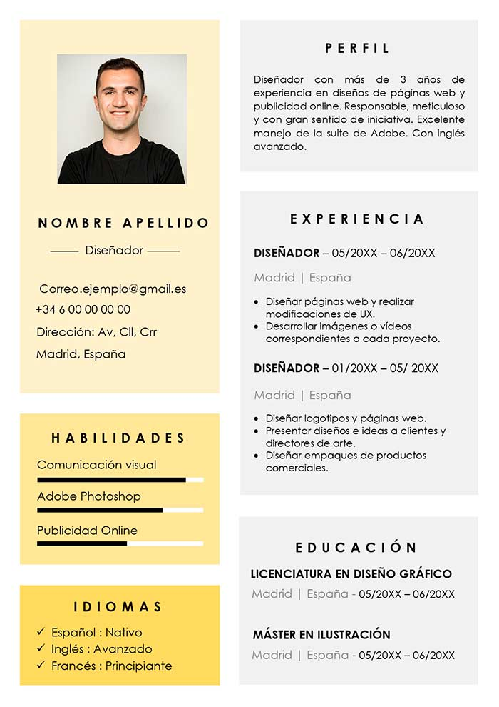

# PREMISA ACTIVIDAD 1 - Curriculum con CSS Externo

1. Crea un archivo llamado Currículum.html con la estructura básica que se da en el ejemplo (puedes usar otro diseño)

2. Crea un archivo llamado styles.css y enlázalo desde el `<head>` del HTML.

3. En el archivo styles.css debes aplicar como mínimo los siguientes requisitos:
   - Uso de div con fondos de colores distintos para separar la zona izquierda y derecha.
   - Estilos para la imagen: tamaño fijo, borde redondeado opcional, márgenes adecuados.
   - Estilos de texto: tipografía, tamaño, color y estilo para títulos, subtítulos y párrafos.
   - Crear clases específicas para:
       .titulo-principal
       .subtitulo
       .label-form
       .btn-enviar (incluyendo efecto hover)
   - Definir una paleta de colores coherente inspirada en el ejemplo (tonos suaves + color destacado).
   - Importar una fuente externa desde Google Fonts (por ejemplo: Poppins, Montserrat, Lato) y aplicarla al documento o solo a los títulos.
   - Ajustar márgenes y padding para que el diseño quede alineado y limpio, similar al estilo del currículum mostrado.

- La entrega debe incluir:
  - index.html correctamente estructurado.
  - styles.css con todos los estilos aplicados.

Imagen de ejemplo:

